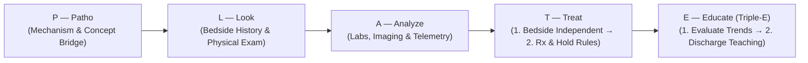
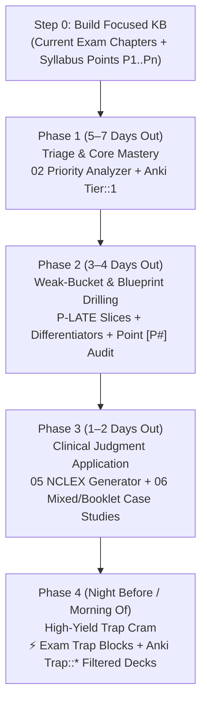

# P-LATE (Triple-E), Tagging System & Exam Study Guide

> **Nursing Study Suite (v21.5) Reference Guide**
> This guide covers the **5-bucket P-LATE (Triple-E)** clinical framework, the **7-dimension hierarchical tagging architecture**, the **Step 01 Textbook TOC & Section Slicer**, the **course-by-course textbook & Giddens concept blueprint**, and the **phased exam-prep sorting workflow** across Knowledge Base, Priority Analyzer, Anki, NCLEX Generator, and Case Studies.

---

## 1. The P-LATE (Triple-E) Framework

**P-LATE** evolved from Straight A Nursing's LATTE method (*Look, Assess, Tests, Treatments, Educate*) to eliminate the single biggest source of study-guide clutter: **the overlap between bedside physical assessment ("Look/Assess") and diagnostic labs ("Tests")**. At the same time, it aligns every condition and medication with the exact bedside-to-discharge clinical judgment sequence tested on **Next Generation NCLEX (NGN)**, **HESI**, and **ATI** exams.



### The 5 Strict Buckets & Subtypes

Every extracted fact in the Knowledge Base is assigned to **exactly one** P-LATE bucket (`latteBucket`) and an optional clinical subtype (`subtype`):

| Bucket | Clinical Scope | Subtypes & Study View Order | Strict Boundary Rule |
| :--- | :--- | :--- | :--- |
| **P — Patho** | Disease mechanism, hemodynamic or cellular driver, etiology, risk factors, classification, drug class, or source-stated mechanism of action (MOA). | • **Concept Bridge** (on Giddens concept exemplars, links the disease mechanism back to its parent physiological concept).<br>• **Pharm:** *Pharmacodynamics & Drug Class*. | Captures the underlying *why*—never bedside signs or diagnostic test values. |
| **L — Look** | Bedside signs, subjective symptoms, physical exam findings, red flags, deterioration cues, and observable adverse/toxic medication effects. | • `early` vs. `late` clinical cues.<br>• **Pharm:** *Adverse Effects & Physical Cues*. | **Zero-Overlap Boundary:** Everything *seen, heard, palpated, percussed, or reported* at the bedside. **Never** contains lab numbers, imaging, or ECG strips. |
| **A — Analyze** | Laboratory values, therapeutic drug levels, imaging, ECG/telemetry findings, diagnostic procedures, exact ranges/units, and diagnostic confounders. | • Gold-standard confirmers & diagnostic tie-breakers (`gold-standard`).<br>• **Pharm:** *Therapeutic Levels & Lab Monitoring*. | **Zero-Overlap Boundary:** Objective laboratory, imaging, and telemetry data. **Never** contains bedside physical exam findings. |
| **T — Treat** | Priority bedside nursing actions, procedures, positioning, medications, doses, routes, timing, hold/notify parameters, contraindications, and antidotes. | Ordered in NGN sequence:<br>1. **Priority Bedside (`independent`):** Immediate RN actions, positioning, airway/O2, safety checks.<br>2. **Pharmacology & Hold Rules (`dependent`):** Provider orders, meds, hold/notify thresholds, antidotes. | Enforces the **Action Split**: what the nurse does *first at the bedside* (`independent`) vs. what requires a provider order or escalation (`dependent`). |
| **E — Educate** | Expected vs. worsening post-intervention response (`T0 → T1 → T2` trends) and patient/family discharge teaching or self-management. | Ordered in NGN sequence:<br>1. **Evaluate Trends (`evaluate`):** Serial trajectory reassessment (`T0 → T1 → T2`) & treatment efficacy.<br>2. **Discharge & Self-Management (`discharge`):** Home care, diet, "further teaching needed" cues, when to seek emergency care. | Separates **inpatient NGN trend evaluation** (`evaluate`) from **outpatient discharge education** (`discharge`). |

---

### The "Triple-E" Clinical Overlay

Why is the framework called **P-LATE (Triple-E)**? Because the final stage integrates three high-yield exam dimensions:
1. **Educate (`discharge`):** Patient/family discharge teaching, lifestyle modifications, and "further teaching is needed" triggers.
2. **Evaluate (`evaluate`):** NGN Q6 post-intervention outcome evaluation—recognizing whether serial vital signs or labs (`T0 → T1 → T2`) show therapeutic recovery, worsening decompensation, or deceptive **pseudo-improvement** (e.g., a *silent chest* in status asthmaticus or *abrupt pain relief* upon appendiceal perforation).
3. **Exam Traps (`trapRole`):** Automatic extraction of **4-Pillar Exam Trap Blocks** across every condition and linked medication:
   - **Pillar 1 — Twin Tie-Breaker (`twin-cue` / `twin-rx-opposite`):** Differentiating look-alike pairs (e.g., *DKA vs. HHS*, *SIADH vs. DI*, *Left vs. Right Heart Failure*, *Crohn's vs. Ulcerative Colitis*).
   - **Pillar 2 — 1st Bedside vs. Rx (`bedside-first` / `ordered-escalation`):** Immediate bedside rescue action vs. ordered pharmacological escalation.
   - **Pillar 3 — Hold & Never-Click (`hold-triangle` / `dynamic-monitor` / `never-click`):** Medication hold thresholds, dynamic safety monitors, and fatal/contraindicated "Never-Click" distractors.
   - **Pillar 4 — Slope Red Flag (`trend-slope` / `pseudo-improvement` / `therapy-overshoot`):** Multi-timepoint serial deterioration (`T0 → T1 → T2`), deceptive pseudo-improvement, and iatrogenic treatment overshoot (e.g., cerebral edema from rapid DKA correction).

> **RN Core vs. NP Mechanism Bridge Firewall (`clinicalLayer`)**
> When uploading sources in Step 01, you can check **RN Core** (*Saunders, lecture slides, med-surg*) alongside **Patho Bridge** (*Porth, McCance*), **Exam / Diff Bridge** (*Jarvis, Bates*), or **Pharm / GDMT Bridge** (*Lehne, clinical guidelines*).
> - **RN Core (`clinicalLayer: 'rn'`):** Bedside cues, safety thresholds, hold rules, and nursing priorities. Included everywhere by default.
> - **NP Bridge (`clinicalLayer: 'bridge'`):** Deep cellular pathways, advanced physical-exam nuances, diagnostic sensitivity/specificity tie-breakers, and guideline-directed therapy rationale. Automatically capped at **Tier 2** (unless safety-critical), tucked into collapsible `<details>` blocks in Study View, tagged `Layer::NPBridge` in Anki, and excluded from Priority, NCLEX, and Case Studies unless **Include NP Bridge facts** is checked.

---

## 2. The 7-Dimension Tagging System

Every flashcard generated by **03 · P-LATE Anki Generator** (and every fact in **01 · Knowledge Base**) carries structured, hierarchical tags. In Anki, double colons (`::`) automatically build a collapsible folder tree in the left sidebar of the Card Browser.

| Dimension | Tag Syntax | Values & Examples | Purpose |
| :--- | :--- | :--- | :--- |
| **1. P-LATE Bucket** | `Nursing::PLATE::<Bucket>` | `Nursing::PLATE::Patho`<br>`Nursing::PLATE::Look`<br>`Nursing::PLATE::Analyze`<br>`Nursing::PLATE::Treat`<br>`Nursing::PLATE::Educate` | Filters cards by clinical workflow stage. |
| **1b. P-LATE Subtag** | `Nursing::PLATE::<Bucket>::<Subtag>` | `Nursing::PLATE::Analyze::Labs`<br>`Nursing::PLATE::Analyze::Diagnostics`<br>`Nursing::PLATE::Treat::Meds`<br>`Nursing::PLATE::Treat::Hold`<br>`Nursing::PLATE::Educate::Evaluate`<br>`Nursing::PLATE::Educate::Discharge` | Drills into specific weak areas (e.g., only lab values, only med hold rules, or only NGN trend evaluation). |
| **2. Exam Priority Tier** | `Tier::<1\|2\|3>` | `Tier::1` *(Must-know / safety / drug / threshold)*<br>`Tier::2` *(Important supporting detail)*<br>`Tier::3` *(Minor detail / deep context)* | Every card has **exactly one** tier tag so you can clear Tier 1 before touching Tier 2. |
| **3. Condition / Topic** | `Condition::<CamelCase>`<br>`Topic::Contrast` | `Condition::LeftSidedHeartFailure`<br>`Condition::Mannitol`<br>`Topic::Contrast` *(Twin/sibling comparison notes)* | Isolates a single disease, standalone drug, or cross-condition comparison card. |
| **4. Giddens Concept** | `Concept::<CamelCase>` | `Concept::Perfusion`<br>`Concept::GasExchange`<br>`Concept::IntracranialRegulation` | Groups all exemplar diseases, Concept Overviews, and linked meds/labs under one physiological unit. |
| **5. Concept Scope** | `Scope::<Kind>` | `Scope::Overview` *(Shared baseline physiology/care)*<br>`Scope::Bridge` *(`[Concept → Exemplar]` patho link)*<br>`Scope::Differentiator` *(⚑ Priority Differentiator)*<br>`Scope::Contrast` *(Sibling exemplar comparison)*<br>`Scope::Delta` *(Exemplar-specific fact)* | Separates foundational concept rules from disease-specific differentiators. |
| **6. Exam Trap Role** | `Trap::<Kind>` | `Trap::TwinContrast`<br>`Trap::TrendSlope`<br>`Trap::PseudoImprovement`<br>`Trap::TherapyOvershoot`<br>`Trap::BedsideFirst`<br>`Trap::OrderedEscalation`<br>`Trap::HoldTriangle`<br>`Trap::DynamicMonitor`<br>`Trap::NeverClick` | Powers high-yield HESI / ATI / NGN cramming by isolating the exact decision traps exams test. |
| **7. Clinical Layer & Quality** | `Layer::<Kind>`<br>`NeedsReview` | `Layer::RNCore`<br>`Layer::NPBridge`<br>`NeedsReview` *(in NCLEX → Anki when a key/choice needs verification)* | Keeps graduate-level patho/pharm bridge content separate from core RN exam prep. |

> **Course & Exam Unit Tags:** If you type `NURS-210` in **Course** and `Exam-2` in **Exam/unit** when building your Knowledge Base, those tags are stamped onto every card automatically—letting you keep all semester cards in a single master Anki deck with **FSRS** scheduling enabled while filtering effortlessly for the current test.

---

## 3. How Best to Sort & Study for an Exam

The suite is designed around **clinical triage**: instead of reading pages linearly or flipping through 700 unsorted flashcards, you work from **highest clinical urgency and exam probability (`Tier 1` + `RN Core`) outward**.



---

### Step 0: Scope & Slice Before You Build (The Golden Rule)

1. **Slice only the exact exemplar sections on your current exam** inside **01 · Source — P-LATE Knowledge Base** (never upload a whole 1,300-page textbook uncut):
   - **Use the built-in `Textbook TOC & section slicer` (`v21.4`):**
     1. Drop your textbook PDFs into Step 01 and open **Textbook TOC & section slicer** under **Step 1 — Setup**.
     2. Enter your exam's exemplars in **Exam exemplars / chapters to find** (e.g., `Heart Failure, Loop Diuretics, Digoxin`) and click **Inspect TOC** on each PDF (100% local, zero API calls).
     3. Click **Select matches** (plus **+ Abnormal Findings** for *Jarvis* or **+ Nursing Process / Prototype boxes** for *McCuistion*) to grab the complete start-to-finish section (narrative prose + diagrams + boxes + tables together) while leaving out untested chapters.
     4. Click **Apply suggested role** so each textbook gets its exact `RN Core` / `Bridge` lens automatically, or run the local CLI helper (`node tools/pdf-toc-slice.js <book.pdf> --query "Heart Failure"`).
   - **Why exemplar-level section slicing beats whole-chapter or table-only uploads:** You keep **100% of the prose depth, mechanism, and nursing process boxes** on your tested exemplars without diluting your Knowledge Base or burning API quota on 25 pages of untested disorders in the same chapter.
2. **Recommended Course-by-Course Textbook & Source Role Stack:**

| Course | Primary `RN Core` (`clinicalLayer: 'rn'`) | Companion Bridge Lens (`clinicalLayer: 'bridge'`) | High-Yield Section-Slicing Tip |
| :--- | :--- | :--- | :--- |
| **Giddens Concepts** *(All Courses)* | **Giddens** (*Concepts for Nursing Practice*) → check **`RN Core`** | — | Upload ONLY the **4–6 page Concept Overview** (`Concept::Perfusion`, `Concept::GasExchange`), not the brief 1-page exemplar snapshots at the back of the Giddens chapter. |
| **Med-Surg** | **Saunders** + Lecture Slides → **`RN Core`** | **Porth's** → **`Patho Bridge`**<br>**Jarvis** *(Abnormal Findings section)* → **`Exam / Diff Bridge`** | Slice Porth's 5–6 page exemplar section + Jarvis's back-of-chapter *Abnormal Findings* tables/paragraphs (skip the 20 pages of normal healthy-adult interview questions). |
| **Pharmacology** | **Saunders** → **`RN Core`**<br>**McCuistion** → **`RN Core` + `Pharm / GDMT Bridge`** *(both checked)* | **Pharm Phlash!** *(Card Intake / rapid recall)* → **`RN Core`** | In McCuistion, slice the prototype drug's prose + *Prototype Drug* box + *Nursing Process: Patient-Centered Collaborative Care* box. |
| **Mental Health** | **Saunders** + Lecture Slides → **`RN Core`** | **Patho Phlash!** *(neurotransmitter & receptor cards)* → **`Patho Bridge`** | Keep therapeutic communication, safety/milieu (suicide/elopement/seclusion), and psychotropic tox/food traps (`MAOI`, `Lithium`, `Clozapine`, `SSRI/NMS`) in `RN Core`. |
| **OB / Maternity** | **Saunders** + **Evolve / Sherpath** packets → **`RN Core`** | **Jarvis** *(Pregnant Female / Breast / Neonatal Abnormal Findings)* → **`Exam / Diff Bridge`** | Pair fetal heart rate (`VEAL CHOP`), labor stages, and high-risk OB emergencies (*Preeclampsia/Mag Sulfate*, *Previa vs. Abruption*, *PPH*) in `RN Core`. |
| **Pediatrics** | **Saunders** + Lecture Slides → **`RN Core`** | **Patho Phlash!** *(congenital/peds cards)* → **`Patho Bridge`**<br>**Jarvis** *(Pediatric Abnormal Findings)* → **`Exam / Diff Bridge`** | Slice Jarvis's pediatric abnormal physical cues (fontanels, retractions, congenital murmurs, dehydration) + Patho Phlash! congenital shunts (`TOF`, `VSD`, `PDA`, `CoA`). |

3. **Paste your instructor's study guide or blueprint bullets into the `Points` box** (one per line).
   - The suite automatically numbers them `P1, P2, … Pn` and links every extracted fact to its matching `[P#]` anchor.
   - Check the **Point-to-Fact Audit** panel right after building:
     - **`0 facts` (Uncovered Points):** Topics on your professor's review sheet that were missing from your uploaded slides—slice and add the textbook section covering those points before you start studying.
     - **`[NONE]` (Unmapped Facts):** Material in the slides/chapters that falls outside your review sheet (deprioritize if pressed for time).
     - **`> 2× Median` (Bleed Suspects):** Broad points carrying most of the exam's weight.
4. **Turn on Concept Mode (`Overarching Concepts` in Step 01):** Enter your unit's Giddens concepts (e.g., `Perfusion, Gas Exchange, Clotting`) and check **Auto-detect overarching concepts from source** so the suite builds a **Sibling Exemplar P-LATE Matrix** and hoists shared nursing care onto the parent Concept Overview without repeating it on every disease card.

---

### Phase 1: 5–7 Days Out — Triage & Core Mastery (`Tier 1` + Concept Overviews)

**Goal:** Lock in life-safety priorities, hallmark findings, and must-know medications before touching secondary details.

1. **Run `02 · Plan — Pyramid Priority Analyzer`:**
   - The analyzer runs a two-stage pass using an explicit clinical priority cascade:
     1. **ABCs** (Airway / Breathing / Circulation — with acute LOC/unresponsiveness threatening airway ranked at the top)
     2. **Crisis / Emergency** (hemorrhage, temp $>105^\circ\text{F} / 40.5^\circ\text{C}$, acute hypoglycemia, pulseless/breathless)
     3. **Psych-Safety** (suicidal/homicidal ideation, violence, elopement)
     4. **Critical Labs** (panic values out of baseline context, plus Organ Hierarchy: $\text{brain} > \text{lung} > \text{heart} > \text{liver} > \text{kidney} > \text{pancreas}$)
     5. **Unstable before Stable** (acute, post-op $<12\text{h}$, newly admitted $<24\text{h}$, worsening trends, or deceptive *pseudo-improvement*)
     6. **Safety & Scope** (black-box warnings, antidotes, hold parameters, high-alert meds, RN vs. LPN vs. UAP delegation)
     7. **Maslow** (physiological before psychosocial)
     8. **Assess before Act** (when a gating verification is required before intervening)
   - **How to study it:** Read the generated **Tier 1** section thoroughly. Every item cites the exact cascade rule it fired (e.g., `R1 ABC`, `R4 CRIT-LAB`, `R6 SAFETY`) and gives you the **testable angle** (how an exam question will frame it).
2. **Review the `Sibling Exemplar P-LATE Matrix` in `01 · Study View`:**
   - For each overarching concept, read the 5-column comparison table (`Exemplar | P — Concept Bridge | L — Hallmark Cue | A — Gold-Standard / Tie-Breaker | T — 1st Bedside / Key Rx | E — Slope / Red-Flag Trend`) to build your mental map of how sibling diseases differ.
3. **Clear `Tier::1` in Anki (`03 · Anki`):**
   - In Anki, go to **Tools → Create Filtered Deck** and use:
     ```text
     tag:Tier::1 tag:Layer::RNCore is:due
     ```
   - Do not study `Tier::2` or `Tier::3` cards until you can answer every `Tier::1` card effortlessly.

---

### Phase 2: 3–4 Days Out — Weak-Bucket & Blueprint Drilling

**Goal:** Target specific weak spots using P-LATE buckets, Concept Scopes, and `[P#]` syllabus points.

Use these exact filters in **01 · Knowledge Base**, **03 · Anki Generator**, or **Anki Desktop/Mobile**:

| If your weak spot is... | How to sort in the Suite UI | Anki Filtered Deck Search Query |
| :--- | :--- | :--- |
| **Telling look-alike diseases apart** | • **KB Facts tab:** Click `⚑ Differentiators`<br>• **03 · Anki Step 01:** Set *Concept / trap scope* to `Priority Differentiators only` | `tag:Scope::Differentiator OR tag:Scope::Contrast OR tag:Trap::TwinContrast` |
| **Lab values, drug levels & diagnostics** | • **KB Facts tab:** Filter bucket by `Analyze` | `tag:Nursing::PLATE::Analyze* tag:Tier::1` |
| **Medications, doses, hold rules & antidotes** | • **KB Facts tab:** Filter bucket by `Treat` or select standalone `[Med]` entries in the left list | `tag:Nursing::PLATE::Treat* OR tag:Trap::HoldTriangle` |
| **Bedside signs vs. late deterioration cues** | • **KB Facts tab:** Filter bucket by `Look` | `tag:Nursing::PLATE::Look*` |
| **NGN post-intervention trend evaluation** | • **KB Facts tab:** Filter bucket by `Educate` | `tag:Nursing::PLATE::Educate::Evaluate OR tag:Trap::TrendSlope` |
| **Discharge teaching ("further teaching needed")** | • **KB Facts tab:** Filter bucket by `Educate` | `tag:Nursing::PLATE::Educate::Discharge` |
| **A specific professor blueprint bullet (`P#`)** | • **KB Step 6 Audit table:** Click any `[P#]` pill to filter the fact browser to that exact point | *(Generate Anki or NCLEX with your `Points` pasted in Step 01)* |
| **Deep patho / NP mechanism understanding** | • **KB Study View:** Expand `NP Bridge` `<details>` blocks | `tag:Layer::NPBridge` |

---

### Phase 3: 1–2 Days Out — Active Clinical Judgment (`05 · NCLEX` & `06 · Cases`)

**Goal:** Transition from single-fact recall (Anki) to multi-cue synthesis, prioritization, and NGN unfolding trajectories.

1. **Systematic Question Drilling (`05 · Practice — NCLEX Question Generator`):**
   - **Mix look-alikes deliberately:** Open **Choose / mix specific conditions** and check confusable pairs together (e.g., *Hyperthyroidism* + *Hypothyroidism*, *SIADH* + *Diabetes Insipidus*, *Placenta Previa* + *Abruptio Placentae*).
   - **Ensure syllabus coverage:** Leave your professor's **Points** in the Points box—the allocator guarantees up to 3 facts per Point are placed at the front of the batches.
   - **Take the Worksheet cold:** Use the **Worksheet** tab (or print to PDF) so answers are hidden.
   - **Audit your misses with the Fact Inspector:** When reviewing the Answer Key, click any cited `[fact-N]` chip on a question you missed. The **Fact Inspector** drawer opens immediately with the verbatim textbook/slide quote and page number, plus every other question or card that tested that fact.
   - **Sweep uncovered facts:** Check the **Coverage Panel** (and **Concept Blueprint Coverage** table) at the bottom of the generator to see which high-yield facts weren't used yet, and run a second batch to cover them.
2. **Unfolding NGN Scenarios (`06 · Practice — Clinical Case Study Generator`):**
   - **Differential / Twin Tie-Breaker Mode:** Select 2–3 sibling conditions and choose **Combine into 1 mixed case → Differential / Twin Tie-Breaker**. Stage 1–2 presents overlapping bedside cues (`Look`), forcing you to rely on diagnostic confirmers (`Analyze`) and targeted interventions (`Treat`) in Stages 3–4.
   - **Interrelated Concept Cascade Mode:** Select a Giddens concept and choose **Interrelated Concept Cascade** to practice how a primary disruption (Stage 1) triggers a secondary concept complication (Stage 2) and a medication/lab hold trap (Stage 3+).
   - **Print a Practice Exam Booklet:** Use **Batch Queue: separate cases** (click `Select ≥8 facts` to auto-select well-grounded conditions) and export the **Packet PDF** in **Booklet (Worksheets → Keys)** mode for a distraction-free paper rehearsal.

---

### Phase 4: Night Before / Morning Of — The 60-Minute Trap Cram

**Goal:** Stop reading background mechanisms (`Patho`) or minor details (`Tier 3`). Focus 100% on the **4-Pillar Exam Traps** where nursing students lose points on HESI, ATI, and course exams.

1. **Rapid Scan in `01 · Study View`:**
   - Scroll to the bottom of each major condition on your exam and read only the **⚡ Exam Trap Block** (5 lines) and **Twin-Diagnosis Contrast Strip** (2-column table).
2. **Build an "Exam Trap" Cram Deck in Anki:**
   - Use **Tools → Create Filtered Deck** with these high-yield queries:
   - **All Exam Traps (Tier 1 & 2):**
     ```text
     tag:Trap::* (tag:Tier::1 OR tag:Tier::2)
     ```
   - **Fatal Errors & Medication Hold Rules Only (15-minute panic review):**
     ```text
     tag:Trap::NeverClick OR tag:Trap::HoldTriangle OR tag:Trap::DynamicMonitor
     ```
   - **"What Does the Nurse Do FIRST?" vs. Provider Orders:**
     ```text
     tag:Trap::BedsideFirst OR tag:Trap::OrderedEscalation
     ```
   - **Worsening Trends & Deceptive "Pseudo-Improvement" Cues:**
     ```text
     tag:Trap::TrendSlope OR tag:Trap::PseudoImprovement OR tag:Trap::TherapyOvershoot
     ```
3. **2-Second Back-of-Card Reinforcement (v21.3 Default):**
   - As you flip through any single-exemplar card in Anki (or in the Suite's **Preview** tab), glance at the **4-Pillar Trap Audit** automatically appended to the bottom of the card back:
     - `[1] Twin:` Look-alike tie-breaker
     - `[2] 1st vs. Rx:` Immediate bedside action vs. ordered therapy
     - `[3] Hold / Never:` Hold threshold or contraindicated action
     - `[4] Slope:` Worsening trajectory or pseudo-improvement cue

---

## Quick-Reference Cheatsheet: Anki Search Queries

Copy and paste any of these into Anki's **Browse** bar or **Create Filtered Deck** dialog:

| Study Goal | Anki Search String |
| :--- | :--- |
| **Must-know RN Core cards only** | `tag:Tier::1 tag:Layer::RNCore` |
| **All Exam Traps across the unit** | `tag:Trap::*` |
| **Never-Click & Hold-Parameter safety check** | `tag:Trap::NeverClick OR tag:Trap::HoldTriangle` |
| **First bedside action vs. ordered escalation** | `tag:Trap::BedsideFirst OR tag:Trap::OrderedEscalation` |
| **Twin look-alike disease contrasts** | `tag:Trap::TwinContrast OR tag:Topic::Contrast OR tag:Scope::Contrast` |
| **Priority Differentiators only** | `tag:Scope::Differentiator` |
| **Lab values & diagnostic tests (`Analyze`)** | `tag:Nursing::PLATE::Analyze*` |
| **Pharmacology & nursing interventions (`Treat`)** | `tag:Nursing::PLATE::Treat*` |
| **NGN post-intervention trend evaluation (`Evaluate`)** | `tag:Nursing::PLATE::Educate::Evaluate OR tag:Trap::TrendSlope` |
| **Single Giddens Concept (e.g., Perfusion)** | `tag:Concept::Perfusion` |
| **Single Condition (e.g., Heart Failure)** | `tag:Condition::HeartFailure` |
| **Flagged NCLEX-to-Anki cards needing check** | `tag:NeedsReview` |
